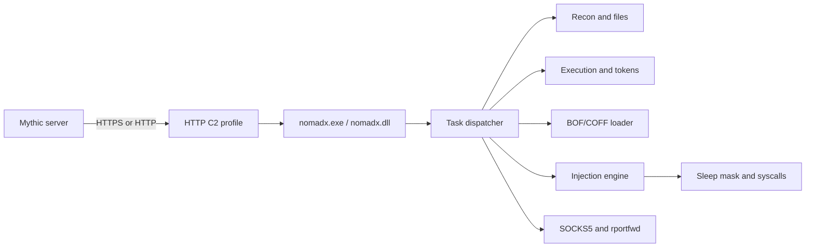

<p align="center">
  
</p>

<h1 align="center">NomadX</h1>

<p align="center">
  <strong>A Zig-native Windows x64 agent for Mythic.</strong><br>
  HTTP C2 · BOF/COFF · process injection · sleep masks · hashed API resolution
</p>

<p align="center">
  
  
  
  
</p>

> [!WARNING]
> **Authorized use only.** NomadX is an adversary-emulation and red-team tool.
> Use it only on systems you own or have explicit written authorization to test.
> You are responsible for complying with all applicable laws and rules of engagement.


## Highlights

- **Native Zig agent** for Windows x86_64 - EXE, DLL, and donut shellcode.
- **Mythic HTTP C2** using the existing AES-256-CBC + HMAC-SHA256 wire format,
  including zero-key plaintext mode for lab testing.
- **Broad command surface**: files, registry, services, tokens, process
  discovery, BOF/COFF, PE loading, SOCKS5, and reverse port forwarding.
- **Multiple injection paths**: fiber, callback, module stomp, module overload,
  threadless `NtClose` hook, KCT, Pool Party, and Early Cascade.
- **Sleep masks**: `ekko`, `ekko_heap`, `rc4_text`, and `rtl_data`.
- **Direct/indirect syscalls** with SSN resolution, a startup self-test, and
  automatic fallback to normal ntdll/Win32 calls.
- **Hashed API resolution**: the PE import table contains only KERNEL32 and
  UCRT. WinINet, Winsock, token, user32, netapi32, iphlpapi, and ntdll APIs are
  resolved lazily by module/function hash.
- **Encrypted embedded config**: UUID, AES key, callback host, and build options
  are not stored as plaintext in the payload.
- **COFF loader parity**: Beacon BOF APIs are resolved by hash, with no
  plaintext Beacon/COFF name table in the image.
- **PE hygiene**: VERSIONINFO metadata, normalized timestamp, and valid PE
  checksum.

## Architecture



The EXE and DLL use the same beacon loop and command dispatcher. DLL builds
export `NomadEntry`, `DllRegisterServer`, and `DllUnregisterServer`; shellcode
builds use the custom donut converter with `NomadEntry` as the entry point.

Deeper design notes are in [`docs/ARCHITECTURE.md`](docs/ARCHITECTURE.md).

## Requirements

- **Build host:** Linux (recommended) or Windows
- **Compiler:** Zig **0.17.1**
- **Python:** 3.11+
- **Mythic:** 3.x with the `http` C2 profile
- **Cross-build tools:** `mingw-w64` for VERSIONINFO/windres and the custom
  donut converter
- **Testing:** a Windows x64 VM or host for live payload validation

## Quick start

### Build and test locally

```bash
git clone https://github.com/django-88/NomadX.git
cd NomadX
python3 -m venv .venv
. .venv/bin/activate
python -m pip install -r requirements-dev.txt
zig build
zig build test
python3 -m pytest -q
```

The default build produces `zig-out/bin/nomadx.exe` and
`zig-out/bin/nomadx.dll` for `x86_64-windows-gnu`.

### Deploy to Mythic

```bash
export MYTHIC_DIR=/path/to/Mythic
./tools/deploy_mythic.sh
```

The script syncs this payload type into
`$MYTHIC_DIR/InstalledServices/nomadx`, registers the `nomadx` service, rebuilds
its container, and starts the required Mythic services. It does **not** modify
the original C++ `nomad` payload type.

After deployment, open the Mythic UI, create a payload, select **nomadx** and
the **http** profile, then choose the build options below.

### Local mock C2

For development without a full Mythic deployment:

```bash
export SMOKE_UUID=11111111-1111-1111-1111-111111111111
python3 tools/mock_c2.py --bind 0.0.0.0 --port 8080 --uuid "$SMOKE_UUID"

python3 tools/build_payload.py \
  --host http://<linux-ip> \
  --port 8080 \
  --uuid "$SMOKE_UUID" \
  --interval 1 \
  --jitter 0 \
  --output dist/nomadx_smoke.exe
```

Run the resulting EXE on Windows and watch the mock server. See
[`SMOKE_TEST.md`](SMOKE_TEST.md) for the full local and Mythic test matrix.

## Build options

The Mythic builder exposes the same pacing, allocation, guardrail, syscall, and
metadata controls as the C++ payload.

| Option | Values / default | Purpose |
| --- | --- | --- |
| `output_type` | `exe` / `dll` / `shellcode` | Delivery format. `stager` is not implemented yet. |
| `alloc_strategy` | `memory_hole` (default), `standard` | Prefer allocations near ntdll, or use normal allocation. |
| `sacrificial_process` | empty | Override the target for threadless, Pool Party, and Early Cascade. |
| `pre_sleep_seconds` | `0` | Native delay before any C2 or injection activity. |
| `injection_step_delay_ms` | `0` | Native delay between injection phases. |
| `require_domain_joined` | `false` | Exit unless the host is domain-joined. |
| `enable_pe_metadata` | `true` | Stamp innocuous VERSIONINFO on EXE/DLL. |
| `pe_company` | `Acme Corporation` | VERSIONINFO CompanyName. |
| `pe_product` | `Acme Update Service` | VERSIONINFO ProductName / FileDescription. |
| `injection_techniques` | `all` | Compile all, a preset, a single technique, or none. |
| `default_injection_technique` | `none` | Technique used by generic `inject` when empty. |
| `use_direct_syscalls` | `true` | Master switch for the private syscall stub layer. |
| `syscall_mode` | `indirect`, `direct`, `none` | Indirect ntdll gadget, own `syscall`, or normal exports. |
| `enable_anti_sandbox` | `true` | Uptime, screen, username/computer, and `win.ini` checks. |
| `enable_computational_delay` | `true` | QPC-based Fibonacci delay instead of plain `Sleep`. |
| `enable_anti_emulation` | `true` | Timing, failed-call, environment, WinAPI, CPU, and large-alloc checks. |
| `enable_anti_debug` | `false` | PEB, `ProcessDebugPort`, and `ProcessDebugObjectHandle` checks. |
| `verify_tls` | `true` | Validate the C2 TLS certificate. Disable only for a known lab certificate. |
| `sleep_mask` | `ekko` | `none`, `ekko`, `ekko_heap`, `rc4_text`, or `rtl_data`. |
| `enable_dllmain_start` | `false` | Start a DLL build from `DllMain` for sideloading. |

## Commands

NomadX registers 67 Mythic commands. See
[`docs/COMMANDS.md`](docs/COMMANDS.md) for the full list. Highlights:

- **Recon:** `pwd`, `ls`, `cat`, `ps`, `whoami`, `ipconfig`, `arp`, `routeprint`,
  `dnscache`, `env`, `locale`, `uptime`, `windowlist`, `wmi-query`,
  `net-localgroup`, `net-user`, `net-session`, `nslookup`, `ldapsearch`,
  `sysmon-check`, `pslist-handles`
- **Files:** `cp`, `mv`, `rm`, `mkdir`, `download`, `upload`
- **Execution / BOF:** `shell`, `register_file`, `register_coff`,
  `execute_coff`, `execute_pe`, `screenshot`, `clipdump`, `reg-query`,
  `reg-set`, `reg-delete`, `sc-create`, `sc-query`, `sc-start`, `sc-stop`,
  `sc-delete`, `sc-enum`, `sc-qc`, `sc-qdescription`
- **Injection:** `inject`, `inject_fiber`, `inject_callback`,
  `inject_threadless`, `inject_kct`, `inject_poolparty`,
  `inject_earlycascade`, `inject_module_overload`
- **Tokens:** `getprivs`, `steal_token`, `rev2self`, `make_token`,
  `token_store`, `blockdlls`
- **Proxy:** `socks`, `rportfwd`
- **Agent:** `sleep`, `exit`, `shutdown`, `selfdel`

## Hardening notes

NomadX applies several static and runtime hardening measures that are useful to
understand during detection engineering:

- The import table is limited to KERNEL32 and UCRT. Other APIs are resolved by
  hashed module/function lookup at first use.
- The embedded config is encrypted at stamp time; the checked-in placeholder
  contains only a zero key and localhost defaults.
- The COFF loader stores Beacon API hashes rather than names and resolves BOF
  imports by hash.
- PE timestamp and checksum are normalized after linking.
- Direct/indirect syscall stubs are built in private executable memory and are
  validated by an allocate/write/protect/free self-test before use.
- Sleep masks encrypt the image and, for `ekko_heap`, busy non-default heap
  blocks.

No agent is undetectable. Treat these as engineering controls, not a guarantee.
See [`SMOKE_TEST.md`](SMOKE_TEST.md#static-hardening-checks) for verification
commands.

## Operational notes

- Injection and sleep-mask testing should be done in an isolated lab VM. Real
  time Defender/EDR can block remote injection and remove remote allocations.
- Default guardrail builds use `user32!GetSystemMetrics`. Launch them in an
  interactive session; launching from Task Scheduler session 0 can block during
  user32 initialization.
- For `threadless`, the sacrificial process must be long-lived and should call
  `NtClose` frequently. Avoid short-lived processes.
- For `memory_hole` + `sacrificial_process`, use a target that stays alive long
  enough to receive the payload.
- `blockdlls` is one-way once enabled; Microsoft-signed-only policy persists for
  the process.
- `make_token` uses `LOGON32_LOGON_NEW_CREDENTIALS`; use a stolen primary token
  when a full `CreateProcessAsUserW` token is required.

## Project layout

```text
build.zig               Zig EXE and DLL build targets
Dockerfile              Mythic payload-type container
main.py                 Mythic container entry point
src/
  main.zig              Windows EXE entry point
  lib.zig               DLL exports and optional DllMain start
  agent.zig             Beacon loop and task dispatcher
  config.zig            Encrypted embedded config parser
  crypto.zig            Mythic AES-CBC/HMAC envelope
  http.zig              WinINet transport
  commands.zig          Command implementations
  coff.zig              COFF loader and Beacon API
  inject.zig            Injection techniques and execute_pe
  sleep.zig             Sleep masks and thread quiescing
  syscalls.zig          Direct/indirect Nt* stubs and self-test
  guardrails.zig        Anti-sandbox/emulation/debug and pacing
  api.zig               Hashed lazy Win32/NT export resolver
  obf.zig               Compile-time string obfuscation
  alloc.zig             Page allocator backed by hidden wrappers
  win32.zig             Win32/NT declarations and lazy wrappers
  beacon_shim.c         C varargs shim for Beacon printf APIs
nomadx/
  mythic/               Mythic payload type and command definitions
  bof_files/            BOF objects (nx_*.x64.o) shipped with command modules
  custom-donut/         Custom donut shellcode converter
tools/
  deploy_mythic.sh      Install/rebuild the nomadx payload type
  build_payload.py      Local stamped payload builder
  mock_c2.py            Local Mythic-compatible test server
  gen_config.py         Config template/encryption helper
  pe_fix.py             PE timestamp/checksum normalizer
  mythic_*_test.py      Live Mythic test suites
tests/                  Python unit tests
docs/                   Public docs and artwork
```

## Testing

```bash
python3 -m pip install -r requirements-dev.txt
zig build test
python3 -m pytest -q
```

Live Mythic suites:

```bash
python3 tools/mythic_live_test.py --callback-display-id <id>
python3 tools/mythic_file_test.py --callback-display-id <id>
python3 tools/mythic_bof_test.py --callback-display-id <id>
python3 tools/mythic_token_test.py --callback-display-id <id>
python3 tools/mythic_proxy_test.py --callback-display-id <id>
```

The token and proxy suites require a lab VM with the appropriate privileges and
network configuration. See [`SMOKE_TEST.md`](SMOKE_TEST.md) for details.


## Credits

- [mgeeky](https://github.com/mgeeky)
  
- [Mr.Un1k0d3r](https://github.com/mr-un1k0d3r)

- [Kharon](https://github.com/entropy-z/Kharon) - thanks for the BOF objects and
  post-exploitation patterns used by several commands. The BOF objects remain
  subject to Kharon's upstream license.
- [Apollo](https://github.com/MythicAgents/Apollo) - a .NET Framework Windows
  agent for Mythic; design reference for command and operator UX patterns
  (BSD 3-Clause). No Apollo source code is included in this repository.
- [Donut](https://github.com/TheWover/donut) - BSD 3-Clause
- [Mythic](https://github.com/its-a-feature/Mythic) - Mythic framework and
  payload container APIs

See [`THIRD_PARTY_NOTICES.md`](THIRD_PARTY_NOTICES.md) for attribution, license
texts, and details.

## License

BSD 2-Clause for the NomadX agent and tooling. See [`LICENSE`](LICENSE).

Bundled BOF objects and other third-party components remain under their
respective upstream licenses; see [`THIRD_PARTY_NOTICES.md`](THIRD_PARTY_NOTICES.md).
